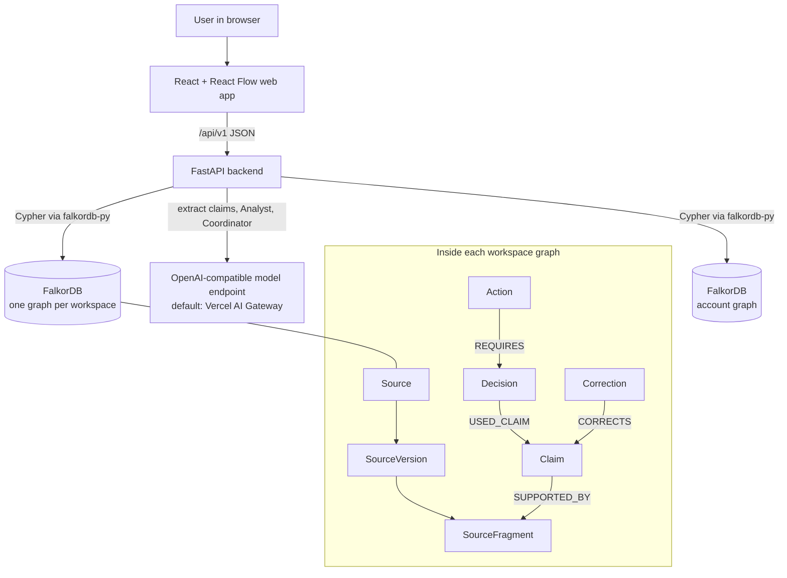
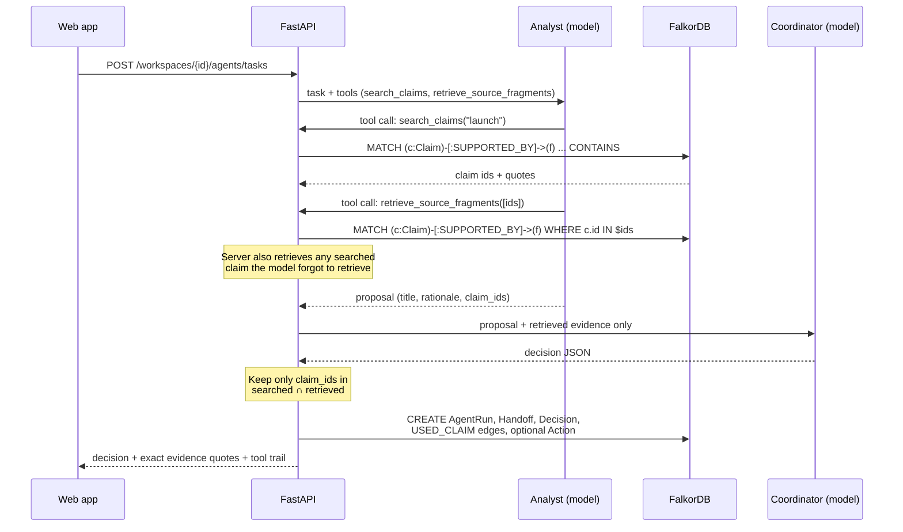
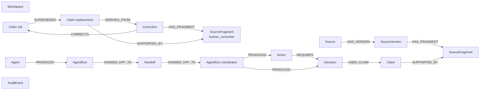

# Architecture and graph data model

[← Back to README](../README.md)

## Architecture



**Responsibilities**

| Component | Responsibility |
|---|---|
| `apps/web` | React 18 + TypeScript + Vite UI. React Flow renders the graph view returned by the API. It never talks to FalkorDB or the model directly. |
| `apps/api` | FastAPI. It owns every rule: auth, workspace ownership, exact-quote validation, the agent evidence gate, revision checks, idempotent corrections and dependency repair. |
| FalkorDB | The source of truth. One graph per workspace (`recall_<uuid>`), plus one account graph (`ACCOUNT_GRAPH_NAME`). Compose runs it with append-only persistence on a named volume. |
| Model endpoint | Any OpenAI-compatible Chat Completions endpoint that supports tool calling and JSON mode. Defaults to Vercel AI Gateway. Called **only** from the server. |

**Request flow for an agent task**



---

## Graph data model

### Workspace graph (one per workspace)



### Nodes

| Label | Key properties | Meaning |
|---|---|---|
| `Workspace` | `id`, `name`, `owner_id`, `revision` | Root of a workspace. `revision` goes up on every business write and is used for stale-preview detection. |
| `Source` | `id`, `name`, `authority` | A submitted document or note. |
| `SourceVersion` | `id`, `content`, `created_at`, `status` | The submitted content, kept unchanged. |
| `SourceFragment` | `id`, `text`, `start_offset`, `end_offset`, `origin_type`, `origin_name` | The evidence text a claim points at. `origin_type` is `source` (from a document) or `human_correction` (from a reviewer). |
| `Claim` | `id`, `statement`, `subject`, `predicate`, `value`, `evidence_quote`, `evidence_start`, `evidence_end`, `status`, `confidence`, `confidence_kind`, `revision` | One extracted fact. `status` is one of `proposed` / `accepted` / `contested` / `superseded` / `retracted`. `confidence_kind` is `model_extraction` or `human_correction`. |
| `Correction` | `id`, `corrected_statement`, `reviewer_note`, `created_at`, `status` | A reviewer's fix to a claim. |
| `Decision` | `id`, `title`, `rationale`, `uncertainty`, `status`, `support_requirement` | Coordinator output. `status` is `draft` or `needs_review`. |
| `Action` | `id`, `title`, `status`, `idempotency_key` | Proposed work that depends on a decision. `status` is `proposed`, `approved` or `held`. Actions are proposals only and are never executed. |
| `Agent` | `id`, `role`, `name` | `analyst` and `coordinator`. |
| `AgentRun` | `id`, `role`, `task`, `model`, `duration_ms`, `tool_calls`, `evidence_ids` | One model run, including its tool trail. |
| `Handoff` | `id`, `status`, `artifact` | The Analyst's structured proposal passed to the Coordinator. |
| `AuditEvent` | `id`, `type`, `payload`, `created_at` | Event log: `workspace.created`, `source.ingested`, `correction.applied`, `correction.reconciled`. |

### Relationships

| Relationship | Direction | Meaning |
|---|---|---|
| `HAS_VERSION` | `Source → SourceVersion` | A source has submitted versions. |
| `HAS_FRAGMENT` | `SourceVersion → SourceFragment`, `Correction → SourceFragment` | Where evidence text lives. Whatever it hangs off decides its provenance. |
| `SUPPORTED_BY {role}` | `Claim → SourceFragment` | The claim's evidence. `role` is `primary` or `reviewer_correction`. |
| `SUPERSEDES` | `old Claim → replacement Claim` | The correction history is kept. |
| `CORRECTS` | `Correction → old Claim` | Which claim the reviewer fixed. |
| `DERIVED_FROM` | `replacement Claim → Correction` | Where the replacement came from. |
| `USED_CLAIM` | `Decision → Claim` | **The dependency edge.** The decision relied on this claim. |
| `REQUIRES` | `Action → Decision` | The action needs this decision to stand. |
| `PRODUCED` | `Agent → AgentRun`, `AgentRun → Decision / Action` | Who produced what. |
| `HANDED_OFF_TO` | `AgentRun → Handoff → AgentRun` | Analyst → Coordinator handoff chain. |

Direction is deliberate: claims point to their support, decisions point to the claims they used, and actions point to the decisions they need. "What depends on X?" is therefore always a walk backwards along incoming edges.

### Account graph (one, fixed by the server)

```
(:User {id, email, password_hash, created_at})-[:OWNS_WORKSPACE]->(:WorkspaceReference {id, name, owner_id, created_at})
(:AccountCatalog {id:'afterhack-account-catalog'})
```

`AccountCatalog` is a seed node, merged on every access, because FalkorDB can't run a read query against a graph that doesn't exist yet.

### What the UI shows

The graph API returns a **product-level view**: only `Source`, `Claim`, `Decision`, `Action` and `Correction` nodes, joined by `SUPPORTS`, `USED_CLAIM`, `REQUIRES`, `SUPERSEDES` and `CORRECTS`. `SUPPORTS` is computed by walking `Source → SourceVersion → SourceFragment ← Claim`. Versions, fragments, runs, handoffs and audit events are still stored and used, but they're hidden so the graph answers "what breaks if this is wrong?" instead of looking like a database dump.
